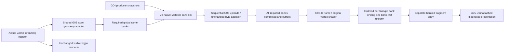

# G06-B — production-banked direct Metal (Prompt 09/25)

MIT; Copyright (c) 2026 Horizon contributors. Original attribution preserved.

## A — Repository

Exact clean baseline `d304cb1e1f772a26a5c57a920ecc337e591e2e8e`, branch
`feature/helium-g06-real-world-metal`. Continuation:
`feature/helium-g06-production-banks`. Tested source SHA and final report-only SHA
are recorded in the final evidence/owner response. No main merge, IPA, proprietary
resources, credential or dependency/lockfile changes.

## B — Architecture



The existing `Material<S>` now has a private versioned bank-set mode, constructed
only by `TerrainRenderer::create_material_set`. It owns one persistent independent
MTLTextureType2DArray per supplied bank (one to eight). `bank_mut(bank)` provides the
existing bounded upload/poll/update operations. No public flag can mark residency
successful. Every member must have completed native upload, compatible metadata,
live source authority and the same generation/revision before frame encoding.
An unused bank need not exist; no dummy textures or full-atlas concatenation occur.

Changed files:

- `experiments/metal-prototype/src/banks.rs`: namespace validation, required-bank
  selection from indexed real 24-byte vertices, shared-source accounting.
- `src/upload.rs` (same experiment prefix): additive BANKED_VERSION=2, family/policy
  validation, optional live CPU ownership accounting key, private identical-byte
  residency adoption. Legacy VERSION=1 retains its original 256-slice policy.
- `src/terrain/metal/material_upload.rs`: bounded set construction, member authority,
  exact unchanged-content adoption, aggregate/per-bank counters, legacy API guards.
- `src/terrain/metal/material_upload/nonblocking.rs`: bounded current/historical
  CPU-owner observation for accounting; existing completion mechanism unchanged.
- `src/terrain/metal/frames.rs`: checked banked preparation, all source keepalives,
  full set accounting and existing completion/output lifecycle.
- `src/terrain/metal.rs`: immutable banked pipeline and ordered bank dispatch in the
  same G02 draw encoder. Original legacy call remains its own path.
- `src/terrain/terrain_banked.metal`: original small fragment extension.
- `src/terrain.rs`: private layout ceiling parameter; legacy policy unchanged.
- `src/lib.rs`: export bank namespace module.
- `src/upload/tests.rs`: CPU and genuine native banked regression tests.
- `crates/horizon-metal-bridge/src/runtime.rs`: remove bank-zero assumptions, acquire
  required real BankSources, upload sequentially, invoke the banked renderer.
- `crates/horizon-metal-bridge/src/material_adapter.rs`: expose actual immutable
  snapshot ownership identity for accounting, never for authorization.
- `.github/workflows/helium-metal-upload.yml`: narrow continuation coverage and
  explicit iOS15 MSL compilation of the combined legacy/banked source.
- `experiments/metal-prototype/docs/G06-B.md`: this report.

## C — Production metadata

Global IDs remain stored in the original u16 vertex field. `global=layer&0x7fff`,
`bank=global/split`, `local=global-bank*split`. Division partitions the original
namespace; it never wraps an ID into an unrelated smaller texture. The selected
bank must exist and local must be below used, not merely allocated. Mesh validation
checks original indices, finite positions and flat per-triangle layer/flag values.

Sets require a common generation, revision, split, sprite count, square dimensions,
full mip count, RGBA8 format and layer-major/mip-major layout. Each bank has exact
`used=min(sprites-bank*split,split)`, nonzero used, allocated>=used and <=512. Bank
IDs are unique, below eight and within the namespace. Splits 1..2048 remain real
production metadata; each NEEDED allocated array independently obeys the v2 512
policy. Thus a small partial bank may be usable with a larger namespace split,
without renumbering or requiring an unused oversized bank. Unsupported referenced
arrays reject instead of being truncated. Production's default Metal split remains
512; no HORIZON_SPRITE_SPLIT override is silently set.

## D — Actual GPU support

V2 requires queried Apple4..Apple10 or Mac1/Mac2 support, plus the existing recognized
baseline/sample-count/maxBufferLength checks. Older/unrecognized families reject
conservatively. Apple's Metal feature tables document 2D array capacities above this
512 policy for these families; there is no invented general max-array getter.
The 4096-side guard remains. Allocation may still fail and is explicitly checked.
The policy is tested by actual sampling, not inferred from successful allocation.
Reference: https://developer.apple.com/metal/Metal-Feature-Set-Tables.pdf

The new native test creates independent arrays of 512, 512 and 4 allocated slices,
using actual 2x2 + 1x1 complete mip chains. It samples global 0,255,256,511,512 and
1026 (bank two/local two, last used of a 3-used/4-allocated partial bank). Padding
contains distinct data in the fixture, while CPU checks reject any attempt to
address it as a sprite. Exact GPU pixel checks are described below.

## E — Shader binding

The banked fragment is a SEPARATE entry appended to the unchanged G02 source. It
uses the original vertex shader/24-byte ABI, UV wrapping, point/clamp sampling,
lightmap/tint, alpha cutoff and opaque-bit semantics. Color's high byte remains
metadata. No shader-pack/PBR/HDR/translucency support is implied.

The CPU walks original indexed triangles IN THEIR ORIGINAL ORDER. For each it
binds the validated bank texture at fragment texture(0) and copies bank*split into
fragment buffer(0) using Metal's setFragmentBytes. Vertex buffers(0/1) and vertex
lightmap texture(0) are separate stage bindings. The fragment masks the original
opaque bit then subtracts this first-global value to sample the exact local slice.
No dynamic array-of-textures/argument-buffer feature is assumed. Every draw references
the same original index buffer/offset and vertex bytes, with no rewriting, sorting,
bank grouping reorder or interpolation quantization. This favors auditability over
minimizing draw calls; batching adjacent runs is future optimization, not claimed.

## F — Independent image correctness

The new oracle checks EVERY pixel of a 96x16 image analytically. Six foreground
stripes select different bank/boundary IDs; a farther bank-one backdrop verifies
cross-bank reversed-Z occlusion and visibility through cutout. RGB values are
independently computed from GLOBAL IDs, so wrong bank/local aliases fail. The first
image uses cutout; the second sets opaque flags and reverses every triangle's order.
All RGBA bytes must equal expectations exactly. A later partial animation update
changes global 512's pixel and verifies the resulting GPU readback.

The original G02 shader file, full-image expected values/tolerances, geometry ABI
and all legacy native oracles remain unchanged. The old unsupported-version unit
case now uses u32::MAX because version 2 is intentionally supported; its rejection
assertion is preserved. Old v1 256-slice boundary tests still pass.

## G — Async lifetime and animation

All banks upload sequentially under G05's one process-wide permit. Begin/poll never
sleep or wait. The owning diagnostic game worker may defer observations, with its
existing cancellation and deadline. Partial/layer uploads use unchanged G05 checked
mip offsets and omitted-byte verification. No parallel eight-upload scheduler exists.

Set residency checks EVERY member, not only the first bank's receipt. A pending,
failed, released, wrong-device, obsolete or mixed-revision bank blocks drawing.
Frame callbacks retain all CPU bank owners; native retaining commands retain every
bound texture/buffer/pipeline until actual terminal completion. Logical cancellation
never substitutes for GPU retirement. Global G04 gpu_current() is unchanged.

For a revision caused by another bank, `adopt_unchanged` reuses an existing completed
texture ONLY after checking current source authority, same layout/generation, newer
revision, budget and exact complete-bank byte equality. It keeps the original GPU
operation's proven bytes; it issues NO new upload ticket/completion and increments
NO upload count. Old tickets become stale. Changed bytes require a real upload;
new generations/devices cannot be adopted. The native test adopts two unchanged
banks, rejects the intermediate mixed set, partially uploads one changed layer,
and verifies reuse plus the updated GPU pixel. This avoids full uploads of unchanged
banks without inventing a command-completion event.

Release/drop and failure use the existing retaining command/CPU keepalive policy.
Per-bank counters remain available through bank_counters; aggregate upload/texture
counters describe the actual set. Legacy blocking draw and texture-readback APIs
reject a set so they cannot bypass group validation.

## H — Memory

All counts, sizes, mip chains, rows/images, offsets and buffer/device/payload bounds
remain checked before encoding. Set construction checks one-to-eight sources and
metadata overhead BEFORE allocation, then budgets the sum of independent GPU textures,
unique retained CPU owners, largest sequential staging pair and copy metadata.
Frame preparation includes bank descriptor/binding/owner metadata reservations.
No unused native banks are allocated/uploaded by the game bridge.

Production BankSources sharing the SAME live Arc snapshot are counted once, with
shared geometry also counted once. Live Arc addresses identify CPU memory ownership
for accounting ONLY, never GPU resource identity, generation or successful completion.
Both current and historical owners during pending updates are included. Distinct
snapshot wrappers that internally share some COW bank allocations may be conservatively
counted separately; these are logical bounds, not physical RSS. Generic Source
implementations without ownership keys are conservatively counted independently.

G06 budgets remain 64MiB producer observation, 2MiB geometry, 192MiB native payload,
16MiB staging, <=6Mi target pixels; no 6GB application entitlement is assumed.
The native fixture has 20560 initial pixel bytes across three actual textures and
full mip chains; the changed-bank upload writes 20 bytes, while unchanged banks
retain one completed upload each. No process RSS, physical GPU allocation size,
latency, thermal or FPS measurement is claimed. Native counters and policy payload
estimates are not relabeled as hardware memory measurements.

## I — Actual game bridge

The existing Game::update_world/Controller::section and post-render Controller::frame
calls remain authoritative. The candidate uses the full production sprite namespace;
Controller::frame scans actual index-referenced IDs and calls Binding::upload_source
for precisely those bank IDs. Original producer identities, camera matrices and
real generated lightmap flow unchanged. The worker upgrades ONLY its explicit upload
contract to v2, creates the bank set, uploads members and calls the existing Frames
and Display machinery. Final live producer checks cover every retained source.
Diagnostics list bank ID/split/used/allocated and actual upload/frame/presentation
completion counters. There is still one bounded candidate/worker and an UNATTACHED
diagnostic drawable. wgpu remains visible; no physical gameplay display is claimed.

## J — Compatibility/fallback

iOS15 minimum, original wgpu backend, default-disabled feature/env behavior and
world/save/authentication/UI behavior are preserved. No dependency upgrades or
lockfile changes. Unsupported formats/families/budgets/banks/generations fail closed
with actionable diagnostics. The disabled game dependency graph still excludes
both experimental crates. Ordinary expanded solid/cutout sections can now span
nonzero banks; shader packs, PBR, HDR, glass/fluid sorting, LOD and entities remain
outside the supported pass. Continuous gameplay is not implemented here.

## K — Commands and counts

All final commands use Rust 1.95.0/locked dependencies. `P=experiments/metal-prototype/Cargo.toml`.

| Command | Final local evidence |
|---|---|
| `cargo +1.95.0 test --locked --manifest-path "$P"` | 0; 61 passed, 0 failed/ignored; 1 compile-fail doctest. |
| `cargo +1.95.0 check --locked --tests --target aarch64-apple-ios --manifest-path "$P"` | 0; Rust test/library compilation. |
| `cargo +1.95.0 test --locked -p horizon-metal-bridge` | 0; 16 passed, 1 authentic-resource case ignored on Linux. |
| `cargo +1.95.0 check --locked -p horizon-client --no-default-features --features helium-direct-metal` | 0; opt-in game configuration. |
| `cargo +1.95.0 check --locked -p horizon-client --no-default-features` | 0; original backend configuration. |
| `cargo +1.95.0 tree --locked -p horizon-client --no-default-features --prefix none` | 0; no bridge/Metal dependency. |
| `python3 experiments/metal-prototype/tools/test_section_bridge.py` | 0; 7 passed, 1 authentic-resource ignored. |
| `cargo +1.95.0 test --locked -p horizon-client-render --lib gfx::material_snapshot:: -- --test-threads=2` | 0; 9 passed. |
| `cargo +1.95.0 test --locked -p horizon-client-render --lib gfx::animate:: -- --test-threads=2` | 0; runner 12 passed, 1 ignored; two prepared-resource cases return early without assets. |
| `cargo +1.95.0 test --locked -p horizon-client-render --lib mipmap:: -- --test-threads=2` | 0; 2 passed. |
| `cargo +1.95.0 test --locked -p horizon-client-render --lib mesher:: -- --test-threads=2` | 0; 59 passed, 18 ignored (15 resources, 3 benchmarks). |
| `cargo +1.95.0 test --locked -p horizon-client-render --doc material_snapshot` | 0; 1 compile-fail lifetime test. |
| `cargo +1.95.0 check --locked --all-targets --manifest-path "$P"` | 0 |
| `cargo +1.95.0 fmt --manifest-path "$P" -- --check` | 0 |
| `rustfmt +1.95.0 --check --edition 2024 --config skip_children=true crates/horizon-metal-bridge/src/{runtime,material_adapter}.rs` | 0 |
| `git diff --check`, `python3 tools/check_public_tree.py --history`, `git fsck --no-dangling` | 0 |

CPU cases exercise original vertex bytes, namespace boundaries, four-bank IDs,
missing and sparse nonzero sets, padding rejection, mixed revisions/generations,
invalid used/allocated/split/mips, eight-bank bounds, capabilities/budgets, unchanged
receipt invalidation and legacy policy. Existing G05 failure/device/retirement tests
are preserved and remain authoritative for the shared async machinery.

Intermediate failures were repaired, not hidden: old unsupported-version fixture
used now-supported version 2 (changed to truly unsupported value); a native test
loop failed to return its receipt; Apple-only game diagnostics referenced a removed
single-bank variable; the first namespace guard incorrectly conflated split with
allocated slice capacity. Earlier Apple experimental GPU tests passed while the
root bridge job exposed the diagnostic compile error; the overall workflow failed
correctly. No native failure uses continue-on-error. Superseded redundant runs are
canceled where appropriate. Final CI evidence is appended after completion.

## L — Apple validation

The narrow existing workflow adds this continuation and explicitly compiles combined
legacy + banked MSL using real `xcrun --sdk iphoneos metal -target air64-apple-ios15.0
-std=ios-metal2.0`. Native tests run with `--ignored --nocapture --test-threads=1` and
fail the workflow on failure. Root bridge tests/native worker, opt-in macOS game and
iOS ARM64 bridge/game checks remain required. The existing unsigned Swift probe
host compilation is retained; no production IPA/signing/release job is invoked.
Mac GPU execution is separate from physical A16 evidence, which is unverified here.

## M — Authenticity

A: unchanged synthetic G02 regressions. New banked GPU fixtures are synthetic texels
and handcrafted actual 24-byte vertices, not Minecraft artwork or mesher output.
Actual production PreparedTextures functions and typed BankSource are exercised by
the shared bridge worker test, with explicitly synthetic lighting/camera/geometry.
B/C: resource-dependent genuine mesher test remains ignored without owner's prepared
Minecraft resources. D: actual game handoff selects the new banked worker in source
and compiles, but no authentic game-runtime world scene was executed here. No prior
iPad screenshot is reclassified as G06-B gameplay or 512-slice hardware evidence.

## N — Verdict scope

Final implementation verdict follows native/Apple checks below. A scoped implementation
PASS does not establish authentic Minecraft runtime, attached native game presentation,
continuous gameplay or physical iPad performance. Those remain pending regardless
of banked GPU fixture success. The original G04 global GPU-current contract is untouched.

## O — Single next dependency

Exercise this banked handoff with owner-prepared Minecraft resources in the actual
game runtime and connect its verified result to a controlled attached game surface.
This is the next visible-real-scene acceptance milestone; do not begin it automatically.

## P — Prompt accounting

Prompt **09/25**. Stop for owner review. Prompt 10 was not started.

### Final executed Apple evidence / scoped acceptance

**Scoped implementation verdict: PASS.** Authentic Minecraft runtime and physical
A16 gameplay acceptance remain pending. All thirteen core implementation criteria
have source/test/publication evidence; no visible game-frame claim is made.

Tested code: `97846b549016374dfa94d8eb445b0430330f7b0e`.
Successful final workflow:
[43865129293](https://github.com/unfilteredpranxu/Helium-launcher/actions/runs/43865129293).
Actual tools: macOS 26.7.2 ARM64, Xcode 26.6 build 17F113, SDK 26.5. Both
apple-sdk and production-bridge jobs passed. Actual native log summaries were
inspected through the Checks API; compilation alone was not used as GPU evidence.

Final commands on the Apple runner (all exit 0):

```sh
cargo +1.95.0 test --locked --manifest-path experiments/metal-prototype/Cargo.toml
cargo +1.95.0 check --locked --tests --target aarch64-apple-ios --manifest-path experiments/metal-prototype/Cargo.toml
cargo +1.95.0 test --locked --manifest-path experiments/metal-prototype/Cargo.toml -- --ignored --nocapture --test-threads=1
cargo +1.95.0 test --locked -p horizon-metal-bridge
HORIZON_SPRITE_SPLIT=512 cargo +1.95.0 test --locked -p horizon-metal-bridge --lib runtime::ownership_tests::native_worker_from_production_owned_bank_and_typed_section -- --ignored --exact --nocapture
cargo +1.95.0 check --locked -p horizon-client --no-default-features --features helium-direct-metal
cargo +1.95.0 check --locked --target aarch64-apple-ios -p horizon-metal-bridge
cargo +1.95.0 check --locked --target aarch64-apple-ios -p horizon-client --no-default-features --features helium-direct-metal
```

- Experimental macOS suite: **59 passed, 0 failed, 8 initially ignored**;
  **2 compile-fail doctests passed**.
- Explicit experimental native Metal suite: **8 passed, 0 failed/ignored**:
  original seven regressions plus new 512/multibank/mip/depth/partial-update case.
- Root bridge suite: **16 passed, 0 failed, 2 initially ignored**.
- Explicit root native worker: **1 passed, 0 failed/ignored**. The command selects
  the EXISTING production split option externally for this controlled test only;
  game behavior is not silently overridden. Actual PreparedTextures creates the
  three-bank owner; the same worker used by the game renders original global IDs
  0/512/1026 with real shared BankSource values. This remains handcrafted geometry,
  synthetic lighting/camera and synthetic white pixels, NOT B/C/D scene evidence.
- Both opt-in game configurations (macOS and iOS ARM64) and bridge iOS check passed.
- Original, presentation and combined banked MSL compiled for explicit iOS15 using
  the real Apple SDK. Existing unsigned standalone Swift host build succeeded.
  No production IPA/app signing/export occurred.

Actual root native-worker software counters (not physical RAM or gameplay FPS):

```text
bank layouts (bank,split,used,allocated):
[(0,512,512,512), (1,512,512,512), (2,512,3,3)]
vertices=12, indices=18
upload_bytes=20540, texture_payload=20540
submitted_operations=3, completed_uploads=3, pending=0
source_retained=21092 (asserted single shared snapshot + geometry)
staging_peak=393216
frame submitted=1/completed=1, pending=0, readback_bytes=0
frame accounted live=565920, peak=575936
presentation submitted=1/completed=1, readback_bytes=0
presentation accounted peak=1352352; UNATTACHED drawable
```

The new full-image GPU oracle separately passed its exact 512/512/4-array scene,
including complete 2x2/1x1 chains, high slices, last-used partial layer, cutout,
opaque override, farther bank-one backdrop, reversed triangle order, mixed revision
rejection, 20-byte partial update and release rejection. Unchanged banks retained
one completed upload each. All original G02 expected pixels/tolerances remain intact.

The final report-only commit follows this tested SHA. Its remote match and clean
worktree are verified in the owner response. The G06-A base branch remains unchanged.
One next milestone: attach this verified banked worker to a mutually exclusive game
surface and accept an owner-prepared real Minecraft scene, without claiming continuous
playability from a single frame. Prompt 10 was not started.
