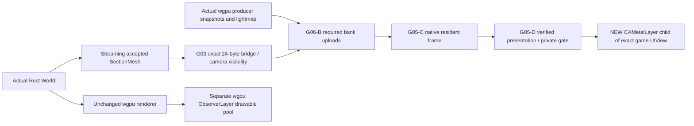

# G06-C — transitional attached native game diagnostic (Prompt 10/25)

MIT; Copyright (c) 2026 Horizon contributors. Original attribution preserved.

**Overall verdict: PARTIAL.** The attached game integration is implemented,
Apple-compiled/linked and published. Real native Metal regressions pass. Authentic
Minecraft world-runtime (category D), attached UIKit runtime and physical iPad
terrain observation remain unverified; no prepared resources are available here.

Exact clean baseline: `ac0239f480599a27e2495a28dda2677ae99f3049`, branch
`feature/helium-g06-production-banks`. Continuation:
`feature/helium-g06-attached-game`. Final implementation AND Apple-tested SHA:
`53f2e803069505026fe552bb04ed62b47f7ab78f`. Later commits only finalize this report;
final report SHA and local/remote equality are supplied in the owner response.
No main merge, destructive reset, signing, release publication or save changes.

## Architecture and ownership

Actual `entry::main_with` / winit application -> `Game::update_world` -> accepted
`Streaming::update` SectionMesh -> existing bounded G03 bridge -> G04 BankSource
snapshots -> G06-B banked upload/draw -> existing G05-D presentation. Camera comes
from `Renderer::views(frame).primary().view_proj(frame.bob * frame.spin)`;
section minus camera is computed in f64. Lightmap pixels/revision come from the
actual production Renderer. No fixture, second world generator or CPU image is
used in the game hook. The existing 24-byte vertices, indices, global sprite IDs,
512-slice/bank checks, ordered triangle draw semantics and oracles are unchanged.

winit's iOS Window exposes its actual UIView through raw-window-handle. The game
passes that live window on its event thread. The native backend validates main
thread/UIKit handle; its synchronous C call passes the borrowed UIView only for
that call. Swift attaches a NEW noninteractive UIView/CAMetalLayer child to that
exact parent. It does not select a connected scene or replace wgpu's backing
layer. SwiftUI launcher remains the root controller's modal overlay. Launcher
presentation removes the diagnostic first. Touch input stays on winit.

Swift owns child-view attachment/removal/layout on main. Weak parent/window and
monotonic Rust IDs prevent old-session reattachment. A dedicated Swift Thread
strongly retains only the separate CAMetalLayer during the synchronous Rust
worker invocation. The Rust CPU registry stores no UIKit/Metal pointers, only a
Send job, atomics and a one-result channel. Native Metal objects are constructed
on that worker, never given unsafe Send/Sync. The bundled launcher framework is
loaded once and stays loaded while C callback addresses exist.

Layer is BGRA8Unorm, explicitly linear-sRGB SDR, timeout-enabled, maximum three
drawables, physical dimensions from the EXACT window screen scale. Reuse existing
RGBA presentation shader/aspect-fit path. Worker verifies actual Metal device
identity. `nextDrawable()` can wait for Apple's timeout, only on the worker.
Submission/poll use genuine G05 command completion; no gameplay/UI GPU wait or
implicit readback. GPU completion is NOT proof of scanout.

The separate child stays alpha-zero until worker success AND a fresh game-thread
producer/mesh/lightmap check authorize one-use publication. This is a one-shot
snapshot, labeled as such, with wgpu still producer/fallback. It expires after
five seconds, or earlier on resize, launcher, background, source invalidation,
mesh replacement/unload or session teardown. A 35-second host lifetime bounds
failed/abandoned attachment. Cancellation never retires Metal work: existing G05
retaining command completion owners do that. Outstanding work remains bounded
by the existing one process-wide GPU permit and one candidate/worker.

## Developer selection and safe device procedure

Normal builds default OFF and keep their normal scheme and bundle identifier.
Existing `HELIUM_DIRECT_METAL=one-section` remains the unattached diagnostic.
Explicit `attached-one-section` is iOS-only. A test bundle must additionally carry
`HeliumNativeMetalTest=true` to read `Documents/helium-metal-test.txt` (at most 64
bytes, bounded read). Exact file values: `off` or `attached-one-section`, optionally
one LF; all other values reject. Environment selection takes precedence. No file
is installed automatically and no credentials or executable code are read.

Use ONLY the isolated test-game bundle `dev.helium.g06ctest`. Do not replace an
existing valued installation or import valued saves. The game executable must be
the actual opt-in Rust arm64 `horizon-client`, embedded with HorizonLauncherKit,
not the unrelated Horizon shell. The dedicated CI job compares executable bytes,
checks Mach-O architecture/minimum OS and exported display ABI symbols. Any
unsigned IPA artifact is for owner signing/install only, no public release.

On the owner's computer with legitimately owned pinned Java Edition 26.3 files,
JDK 25 and existing repository preparation prerequisites:

```sh
cargo run --release -p horizon-prepare -- --prepare --server-jar /absolute/path/to/owned/server.jar
cargo run --release -p horizon-client -- --pack-resources .local/horizon-client/26.3 --out /absolute/path/Horizon-26.3.zip
```

Preparation is off-device; no JVM is added to iOS. Do not upload jars/resources to
GitHub. The source runtime checks a resources directory beside the executable,
then `Documents/resources`, then `Documents/.local/horizon-client/26.3`. Use Files
sharing/cable to put the complete prepared contents under `Documents/resources`,
or use the game's existing import screen with that ZIP. The import's displayed
local port/code is private and must not be committed/shared in logs. See the
existing `packaging/ios/README.md` import procedure. Copy the small opt-in text
file into the isolated game's Documents, fully terminate/relaunch, then use the
existing launcher/game controls to create a NEW uniquely named disposable world
(e.g. `Helium-G06C-Disposable-<date>`), creative mode, no existing saves. Look toward
nearby solid terrain. Do not infer attached acceptance merely from wgpu terrain.

Expected log evidence: Rust entry/window/launcher; resource startup checkpoints;
world-open requested/prepared; wgpu producer initialized; accepted section key,
sequence, generation, camera, lightmap revision; attached layer generation/size;
bank uploads ready; frame submitted/completed; attached presentation submitted;
validated snapshot revealed; session closed. Capture a screenshot showing the
native diagnostic label plus actual terrain, and export only sanitized relevant
logs. If startup stops before world readiness, report its LAST checkpoint rather
than attributing it to Metal. Loading freeze is not claimed fixed without runtime.

Existing boot diagnostics: `Documents/horizon-boot.log`; launcher/display log:
`Documents/logs/launcher.log`; engine log under the configured Horizon home (see
startup log; iOS normally Application Support/horizon/logs/latest.log).

## Bounds and evidence classification

Retained geometry <=2 MiB; opt-in snapshots <=64 MiB shared Arc ownership; native
payload <=192 MiB; upload staging <=16 MiB; frame targets <=6M pixels; drawable
pool <=64 MiB analytical reservation. Existing `Display::present` checks source
live payload plus three BGRA drawable images before acquisition. No full-bank
per-frame copies, no new animation algorithm, no readback, no target history.
Source snapshots retained by a revealed result remain bounded by the same one
snapshot policy and are revoked on producer revision change. Logical/accounted
payload is NOT measured process RSS/physical GPU allocation. No FPS measured.

Platform-neutral gate tests simulate event ordering, cancellation, duplicate
publication and generation isolation, not GPU success. Bridge tests use real
production types with explicitly handcrafted inputs. Existing native regressions
exercise production-owned PreparedTextures with handcrafted pixels (NOT Minecraft
artwork/category C or game runtime/category D). Genuine resources and owner-device
execution remain unavailable here. The runtime entry is wired; no category-D
execution is asserted merely because code compiles.

## Changed files and native ABI

| Path | Change |
|---|---|
| `crates/horizon-client/src/game.rs` | Actual post-wgpu render hook supplies its actual Window; launcher coverage revokes native work; privacy-safe window/resources/world/producer checkpoints. |
| `crates/horizon-metal-bridge/Cargo.toml` | Reuse existing winit version for a safe window handle boundary. |
| `crates/horizon-metal-bridge/src/runtime.rs` | Strict attached selection, original-position frustum filtering, same banked worker with attached target, source-checked one-use reveal, revocation and bounded retained display authority. |
| `experiments/metal-prototype/src/attached.rs` | Audited iOS native layer handoff, ABI validation, one CPU registry, checked unique IDs, panic boundary, safe Rust Ticket and worker-owned Layer. |
| `experiments/metal-prototype/src/attached_protocol.rs` | Shared atomic one-use handoff gate and clearly simulated CPU event tests. |
| `experiments/metal-prototype/src/lib.rs` | iOS-gated attachment export and private protocol module. |
| `experiments/metal-prototype/Cargo.toml` | iOS-only existing libc/raw-window-handle versions for dlopen and validated UIKit raw handle. |
| `Cargo.lock`, `experiments/metal-prototype/Cargo.lock` | Dependency edges/new experiment entries only; no existing dependency upgraded. |
| `packaging/ios/Launcher/NativeDisplay.swift` | Actual UIKit child layer, private sandbox test configuration, rendering Thread, weak UI lifecycle checks, publication/expiry. Included by existing Launcher folder target, not a new app. |
| `packaging/ios/Launcher/Present.swift` | Cancel diagnostic before SwiftUI launcher; checkpoint on dismissal. |
| `.github/workflows/helium-metal-upload.yml` | Narrow source-triggered continuation, real game binary link, full actual framework/app build, isolated unsigned test artifact. No release workflow invocation. |
| `experiments/metal-prototype/src/terrain/metal/presentation.rs` | Bind private reveal proof to actual successful command poll; retain native layer to exact command and clear that lease at real completion; new native ownership regression. |
| `experiments/metal-prototype/src/display/host.rs` | Existing synthetic probe driver exercises the same private GPU proof gate, preserving its C ABI and original fixture. |
| `tools/ci/verify-attached-ios-game.py` | Verify actual arm64 iOS15 game executable, feature marker, framework exports and asset-free isolated artifact. |
| `tests/test_attached_ios_binary.py` | Four explicitly handcrafted binary-metadata guard tests. |
| `experiments/metal-prototype/docs/G06-C.md` | Engineering evidence, safe resource import and device acceptance procedure. |

The game and bridge retain `#![forbid(unsafe_code)]`. No existing native entry
point changes. New ABI v1 consists of C-callable framework symbols:

| Symbol | C-equivalent signature |
|---|---|
| `horizon_native_display_abi` | `uint32_t (void)` returns 1; checked before other symbols. |
| `horizon_native_display_mode` | `int32_t (void)` returns 0/off, 2/attached, -1/invalid. |
| `horizon_native_display_request` | `bool (uint64_t id, void *liveUIView, work_fn, cancel_fn, ready_fn)`; synchronous MAIN only, borrows pointer for this call only. |
| `horizon_native_display_publish` | `void (uint64_t id)`; schedules main validation/reveal, no borrowed callback state. |
| `horizon_native_display_cancel` | `void (uint64_t id)`; schedules main removal, also used by Rust Ticket drop. Repeated/stale ID is harmless. |

Callback types: `void work_fn(uint64_t, void *retainedCAMetalLayer)` (synchronous
WORKER invocation, host retains layer for its whole duration),
`void cancel_fn(uint64_t)` (CPU atomics only), `bool ready_fn(uint64_t)` (CPU gate,
no completion inference). Swift dictionary is main-owned. Mutex registry contains
CPU state only; callbacks do not access borrowed Rust/Swift stack frames. Rust
uses Objective-C retain on the worker and never moves a Metal object between Rust
threads. Framework stays dlopen-loaded for the process (one bounded loader handle).

Queued -> Running requires exact single registry ID and a compare/exchange.
Running -> Ready/Failed occurs when the synchronous worker RETURNS; worker Ok
requires successful exact upload, frame and presentation Metal commands. Ready
is not visible. Game-thread source checks then permit Ready -> Published once;
Swift rechecks atomic cancellation and host lifecycle before alpha changes.
Repeated starts/publications reject. Cancellation is independent of Running, so
pending retirement is not mislabeled complete. No public arbitrary GPU-success
flag or modification of G04's `gpu_current()` exists.

Self-review corrected selection based on a fixed section box: actual baked model
positions can extend outside 0..16. Original positions now drive six homogeneous
clip-plane tests, before retention and again against the dispatch camera. Tests
include real column-major translation, perspective front/behind, crossing
triangles and negative model overhang. This proves conservative clipping only;
it cannot establish nonempty visible terrain pixels or lack of occlusion.

Published-source owners are released on the next game tick after host expiry/
cancellation, or on immediate game invalidation/drop. No stale bank snapshot is
kept as a permanent historical display cache. A new write/revision, reload, window
change, remesh/unload or lightmap change hides the captured result. Source changes
while the worker runs can reject this one-shot attempt; restart the isolated test
session to retry. This fail-closed milestone is not continuous native gameplay.


Additional review corrections:

- Attached mode waits for a real non-title world camera, clears camera state at
  invalidation/world replacement and records a checked local world-install epoch.
  It does not arm a second controller for splitscreen guests or retain attached
  snapshots for offscreen producers. The original unattached diagnostic stays
  compatible. An epoch is a diagnostic/session counter, not a save UUID.
- `src/terrain/metal/presentation.rs` explicitly retains the CAMetalLayer on the
  EXACT native command using Objective-C retained association. A stateless native
  completion block removes it only at terminal Metal execution. It captures no
  layer, command, view or Rust session, and adds no unsafe Send/Sync. Thus UI/view
  removal and worker timeout cannot free the pending layer. Native test verifies
  retention after original owner release and eventual retirement after a real
  successful command; no first-poll Pending assumption or attached-window claim.
- New `tools/ci/verify-attached-ios-game.py` verifies exact Rust/bundle executable
  hashes, real thin arm64 MH_EXECUTE, iOS device load commands/minimum15.0, native
  feature marker, all five defined C exports, bundle contract and absent private
  assets/config/saves before applying the isolated test identity. It uses Python
  and xcrun/nm rather than undeclared shell search tools.
- New `tests/test_attached_ios_binary.py`: four deterministic handcrafted Mach-O
  metadata guard tests, not a real app link or physical execution test.

The first Apple run, SHA `8d448df13bcaaf6ec98533ffa8c152b46135f60c`, actually
linked the opt-in Rust arm64 executable (release build 19m15s) and built the actual
HorizonGame/Swift framework (`BUILD SUCCEEDED`, copied Rust binary 83,774,116
bytes, exact cmp passed, file reported arm64 Mach-O). The workflow then failed
post-link verification with exit127 BEFORE artifact publication. The first bounded
log did not capture the shell executable error; full job-log delivery is blocked
by the cloud log endpoint (403). The replaced rg/otool shell verifier no longer
relies on those undeclared tools. The initial run is NOT reported as a green CI
pass. No test IPA was uploaded by that failed run. The revised code must be
revalidated at its own SHA.


The second Apple attempt (`74cfff25c58618f077b6698e4938e74736850ad0`, run
43882694826) preserved all original eight native GPU passes but failed the NEW
layer weak-deallocation assertion (8 passed, 1 failed). That assertion conflated
the command's lease with all possible native/Core Animation ownership. The
replacement test asserts the exact native association equals the exact layer
before owner release, retains it after owner release, then requires that exact
association to become nil only after genuine command terminal success. Baseline
weak observability is logged independently; immediate system-wide layer death is
not claimed. No original image/ownership oracle is weakened. The superseded run
was canceled before its expensive game rebuild; revised native evidence remains
required, not inferred from an old pass.

The public attached handoff now rejects a worker returning Ok unless the exact
native Presentation::poll successful terminal path confirmed its private gate.
The Layer can claim that gate for only one Display. Gate fields and confirmation
are crate-private; external callers cannot forge success through a job return or
public status setter. A new CPU regression explicitly rejects Ok without native
confirmation. The existing G05-D synthetic probe driver uses the SAME private
proof path, so its real drawable GPU test validates that connection on macOS;
that remains a synthetic/unattached test, not category-D/UIKit runtime. Game
publication still additionally needs fresh producer authority on the game thread.
Changed `src/display/host.rs` solely to exercise/enforce this same proof gate; old
C entry points and image fixtures stay intact.

The actual-game build job now depends on the native SDK/GPU job succeeding, so a
new native failure cannot waste a full game build or produce a misleading IPA.

## Final source audit and reproducible checks

The vendored winit `WinitUIView` is a UIView subclass, NOT MTKView. Its raw handle
exposes that UIView and its controller. Production `Renderer::new` calls
`instance.create_surface(window.clone())`; patched wgpu-hal Metal calls
`raw_window_metal::Layer::from_ui_view`. That MIT/Apache dependency (1.1.0) reads
UIView.layer, and for a normal CALayer inserts its own ObserverLayer/CAMetalLayer
sublayer. It does not search our child UIView for a texture/drawable. New native
presentation owns a separate child view whose layerClass is CAMetalLayer. Both
pools are therefore distinct even though the physical device can be the same.
Neither backend receives the other's drawable or render target. Root surface
failure revokes the diagnostic through the existing post-render hook. No original
winit/wgpu source or normal game scheme/plist was modified.

At source SHA `53f2e803069505026fe552bb04ed62b47f7ab78f`, Apple native evidence
passed: 64 default tests, 9 explicitly executed native tests, 2 compile-fail docs;
zero failures. The runtime log records genuine drawable acquisition, the private
GPU-confirmed reveal gate, unchanged G02/full-image and 512/cross-bank oracles,
and exact layer-association retirement after terminal success. It also records
baseline layer weak observability TRUE even without our lease, confirming that
immediate whole-object deallocation was an invalid ownership oracle. The corrected
test observes the exact command-owned lease. It does not claim driver/Core
Animation cache memory was measured or that a window displayed a frame.

All local shell commands activate:

```sh
export CARGO_HOME=/workspace/toolchains/cargo RUSTUP_HOME=/workspace/toolchains/rustup
export PATH=/workspace/toolchains/cargo/bin:$PATH CARGO_BUILD_JOBS=4
```

| Command (all Cargo +1.95.0, locked) | Exit / observed result |
|---|---|
| `cargo +1.95.0 test --locked --manifest-path experiments/metal-prototype/Cargo.toml` | 0; Linux 66 passed, 0 failed/ignored; 1 compile-fail doc passed. |
| `cargo +1.95.0 test --locked -p horizon-metal-bridge` | 0; Linux 18 passed, 0 failed, 1 authentic-resource test ignored. |
| `cargo +1.95.0 test --locked -p horizon-client-render --lib gfx::material_snapshot:: -- --test-threads=2` | 0; 9 passed. |
| `cargo +1.95.0 test --locked -p horizon-client-render --lib gfx::animate:: -- --test-threads=2` | 0; harness 12 passed, 1 ignored. TWO resource tests return early without real water/kelp resources; those are NOT authentic-resource passes. |
| `cargo +1.95.0 test --locked -p horizon-client-render --lib mipmap:: -- --test-threads=2` | 0; 2 passed. |
| `cargo +1.95.0 test --locked -p horizon-client-render --lib mesher:: -- --test-threads=2` | 0; 59 passed, 18 ignored (15 resource-dependent, 3 benchmark). |
| `cargo +1.95.0 test --locked -p horizon-client-render --doc material_snapshot` | 0; 1 compile-fail lifetime test passed. |
| `python3 experiments/metal-prototype/tools/test_section_bridge.py` | 0; typed adapter 7 passed, 1 authentic-resource test ignored. |
| `cargo +1.95.0 check --locked -p horizon-client --no-default-features` | 0; normal/default game checked. |
| `cargo +1.95.0 check --locked -p horizon-client --no-default-features --features helium-direct-metal` | 0; actual opt-in game checked. |
| `cargo +1.95.0 check --locked --all-targets --manifest-path experiments/metal-prototype/Cargo.toml` | 0. |
| `cargo +1.95.0 check --locked --tests --target aarch64-apple-ios --manifest-path experiments/metal-prototype/Cargo.toml` | 0; Rust target compilation, not Apple link/runtime. |
| `cargo +1.95.0 tree --locked -p horizon-client --no-default-features --target aarch64-apple-ios` + absence assertion | 0; disabled graph excludes horizon-metal-bridge and helium-metal-prototype. |
| `python3 -m unittest discover -s tests -p test_attached_ios_binary.py` | 0; 4 handcrafted metadata guard tests passed. |
| `cargo +1.95.0 fmt --manifest-path experiments/metal-prototype/Cargo.toml --check` | 0. |
| `rustfmt +1.95.0 --check --edition 2024 --config skip_children=true crates/horizon-client/src/game.rs crates/horizon-metal-bridge/src/runtime.rs` | 0; modified production Rust files. |
| `cargo +1.95.0 fmt --all --check` | 1; 14 unchanged baseline files differ under this formatter. Confirmed `git diff ac0239f.. -- <each>` empty. No unrelated formatting rewrite. |
| `python3 tools/check_public_tree.py --history`, `git diff --check`, `git fsck --no-dangling` | 0; no forbidden assets/whitespace/Git defects. |

Explicit G04-C software-compute readback regression, exit0, 1 passed:

```sh
export XDG_CACHE_HOME=/tmp/helium-g04c-cache XDG_RUNTIME_DIR=/tmp/helium-g04c-runtime
export MESA_SHADER_CACHE_DIR=/tmp/helium-g04c-cache WGPU_BACKEND=gl
cargo +1.95.0 test --locked -p horizon-client-render --lib \
  gfx::animate::tests::observed_snapshots_match_gpu_animation_jobs_every_tick \
  -- --ignored --exact --nocapture
```

Observed adapter: llvmpipe LLVM19.1.7 CPU, Mesa25.0.7, OpenGL. This is software
compute parity, NOT native Apple Metal evidence. No prepared Minecraft assets
were used. Existing asset-dependent test classification is preserved.


## Final Apple link, artifact and acceptance (A–Q)

**A — Git.** Exact base above; implementation/tested source
`53f2e803069505026fe552bb04ed62b47f7ab78f`. Code commits `8d448df`, `74cfff2`,
`53f2e80` preserve failed-attempt evidence and subsequent fixes. Dedicated branch
only; final report-only SHA is in the owner response. Public tree/history and
Git integrity checks pass. Dependency changes are the listed reused-version
edges; no existing version was upgraded. No licenses/visibility changed.

**B — Game architecture.** Actual entry, winit UIKit controller/view, resource
loader, real World/Streaming and production mesher remain authoritative. Accepted
meshes are intercepted before pool return, after streamer's worker-generation and
loaded-column acceptance. Actual wgpu frame generates source animation/lightmap
state before native capture. Source flow and view hierarchy are traced above.



**C — Native display.** Transitional attached diagnostic, never primary renderer
replacement. Exact winit UIView, separate child/layer/pool, main-owned attachment,
no touch interception. Never replaces or lends wgpu's surface. Transparent until
GPU proof + fresh producer check; source changes or host lifecycle remove it.

**D — Geometry.** The real Game handoff preserves original bytes/global IDs,
quad indices, section origin, accepted sequence and checked world epoch. Current
actual world-camera clipping filters original vertex positions. Unsupported
translucent/packed/shader-pack input rejects. Tests using handcrafted SectionMesh
structs are NOT called genuine production mesher output or category D.

**E — Materials.** Existing producer-owned BankSources, actual split/used/allocated
counts and exact mip chains; one to eight required banks, genuine versioned
512-slice support, no padding aliasing or remapping. Exact completed bank uploads
and uniform source generation/revision authorize draw. G04 `gpu_current()` stays
unchanged. The native banked fixture again exercised (512,512,3) used/allocated
banks from real PreparedTextures functions with handcrafted pixels.

**F — Camera/lightmap.** Actual frame primary projection/bob/spin and f64 world
subtraction; exact generated 16x16 RGBA8 lightmap/revision, not fixture lighting.
CPU frustum tests are necessary visibility checks, not proof of nonblack output
or occlusion. Authentic output still requires device runtime inspection.

**G — Presentation.** Actual command success/error and source authority drive
completion; no submission/poll GPU wait. Drawable acquisition can wait for Apple's
timeout on the worker. Exact command retains layer until terminal callback;
private proof rejects CPU-only Ok. Existing RGBA-to-BGRA/linear-SDR shader and
corner/alpha oracle unchanged. Command completion/scheduled presentation does NOT
prove display scanout or owner visibility.

**H — iOS linkage.** Final CI actually ran:

```sh
cargo +1.95.0 build --release --locked --target aarch64-apple-ios   -p horizon-client --no-default-features --features audio,helium-direct-metal
HORIZON_GAME_PREBUILT=1 xcodebuild -project packaging/ios/HorizonIOS.xcodeproj   -target HorizonGame -configuration Release -sdk iphoneos -arch arm64   CODE_SIGNING_ALLOWED=NO CODE_SIGN_IDENTITY= CODE_SIGNING_REQUIRED=NO   DEBUG_INFORMATION_FORMAT=dwarf CONFIGURATION_BUILD_DIR="$RUNNER_TEMP/attached-game/build" build
python3 tools/ci/verify-attached-ios-game.py   "$RUNNER_TEMP/attached-game/build/HorizonGame.app"   target/aarch64-apple-ios/release/horizon-client
```

All exit0. Rust release link 12m47s; actual game/Swift UIKit framework build
`BUILD SUCCEEDED`. Executable **83,775,028 bytes**, SHA256
`99a804e442d4ec6ad9b16e91dd6b59f86e0b29c9bcc665912ee101a5778e88ba`.
Verifier proved exact Rust/bundle hash equality, thin arm64 MH_EXECUTE, device
iOS load command/minimum15.0, feature marker, five defined native C exports,
correct CFBundleExecutable and absent resources/saves/config/jars. Only the test
artifact is rewritten to `dev.helium.g06ctest`, “Helium G06C Test”, test markertrue.
Default scheme/source plist remain unchanged. Activation file absent, so OFF.

**I — Lifetime/memory.** One primary candidate/worker and one global native GPU
permit. Geometry2MiB, observation64MiB, native payload192MiB, staging16MiB,
frame<=6M pixels and three-drawable reservation<=64MiB. Display charges its live
payload plus drawable pool; the drawable reservation is not an extra arbitrary
6GB allowance. Existing wgpu/world memory is outside these added-native payload
limits. Shared CPU snapshot Arc references count once; separate native banks and
aligned staging count separately. Native ownership metadata (one association and
completion block per presentation) is bounded but driver/ObjC physical overhead
was not measured. No physical RSS/peak GPU memory claim. UI cancel never fakes
retirement; historical sources/layer remain owned until true completion.

**J — Tests.** Local command/count table above. Latest Apple experiment default:
64 passed, 9 ignored; docs2 passed. Explicit native9 passed/0failed/0ignored.
Apple bridge default18 passed/2ignored, explicit synthetic native-worker1 passed.
One bridge ignore is resource-dependent; the other is the explicitly executed
native test. Apple host/opt-in/iOS bridge/iOS game checks all exit0. Binary guard
4 tests passed, disabled dependency assertion passed. Full root formatting1 is
an evidenced pre-existing mismatch in 14 untouched files; scoped formatters0.
Authentic resources unavailable, asset tests remain classified accurately.

**K — Apple CI.** Final successful run:
[43884471515](https://github.com/unfilteredpranxu/Helium-launcher/actions/runs/43884471515),
exact source `53f2e803069505026fe552bb04ed62b47f7ab78f`. All three jobs passed.
Observed macOS26.7.2 arm64, Xcode26.6 build17F113, iPhoneOS/macOS SDK26.5.
Actual macOS Metal9 execution logs were read through the Checks API, including
all native names/results; no green-status-only inference. Original and combined
banked/presentation MSL compiled with `air64-apple-ios15.0 -std=ios-metal2.0`.
Original unsigned probe host and actual game UIKit framework/app linked. Linux
has no Apple SDK; its target check alone is not used as linking evidence.

One authorized unsigned owner-test game artifact was uploaded:
[Helium-G06C-isolated-game-unsigned](https://github.com/unfilteredpranxu/Helium-launcher/actions/runs/43884471515/artifacts/14236000941)
(artifact size34,500,307 bytes). Contains `Helium-G06C-game-unsigned.ipa`, actual
game plus framework, no proprietary prepared resources, tokens, saves or activation
file. No public release, signing or production release workflow. Earlier failed/
canceled runs uploaded no test IPA. Evidence log artifacts remain on the run.

**L — Prepared resources.** Exact owner preparation/import/disposable-world
instructions above, derived from Options::parse/read, import::resources_root,
GameInfo.plist and current packaging README. No files were downloaded or invented.
Evidence A: synthetic GPU fixtures, including production types/functions with
handcrafted pixels/geometry; B: existing production mesher regressions where they
actually invoke the mesher with controlled inputs; C: unavailable authentic
prepared Minecraft assets; D: unavailable actual game-runtime world frame. A
handcrafted SectionMesh is not silently promoted into B/C/D.

**M — Physical iPad.** G06-C UNVERIFIED. Prior owner-reported G05-D visible frame
is acknowledged, not reused as acceptance for this game/512-bank/lifecycle path.
Actual attached UIKit hierarchy, input pass-through, launcher z-order, rotation,
background/resume, source invalidation on an installed game, and owner-visible
terrain need the isolated device procedure. No headless or offscreen test is
called an attached-window presentation pass. No loading-freeze resolution claimed.

**N — Performance.** No gameplay FPS, latency, frame pacing, thermal behavior or
A16 memory measurement. Runtime diagnostics expose actual software operation/
payload counts when invoked. Native fixture measured software counters:
3 bank uploads, 20,540 upload bytes, 393,216 staging peak, shared retained source
21,092 bytes, one frame and one presentation, no implicit diagnostic readback.
These are handcrafted-fixture accounting values, not world/A16 performance.
Ordered per-triangle binding remains a proof path, not a throughput claim.

**O — Verdict.** **PARTIAL overall.**

| Acceptance boundary | Result |
|---|---|
| Actual-game reachable opt-in seam, exact source/camera/lightmap, banked backend, bounded ownership | Implemented; CPU/native core tests and iOS compilation pass. |
| Real arm64 GAME and Swift UIKit host final link, native regressions, publication | PASS at exact tested source above; isolated owner artifact available. |
| Attached-to-window UIKit runtime/lifecycle behavior | UNVERIFIED; macOS test drawable is unattached. |
| Authentic loaded world/streamed terrain reaching attached native display (D) | UNVERIFIED: owner-prepared resources/runtime unavailable here. |
| Physical iPad terrain/scanout and sustained gameplay | UNVERIFIED; no FPS claim. |

**P — Single next dependency.** Owner-run acceptance of THIS isolated game build
with legally prepared26.3 resources in a fresh disposable world: observe the
native diagnostic label AND real terrain, then correlate sanitized stage logs.
That one test determines the next actual defect/dependency; do not optimize or
start another milestone before its evidence.

**Q — Prompt budget.** Prompt10/25. Prompt11 not started. Stop for owner review.

Cloud setup follow-through: reusable install/start draft now also pins Rust1.95.0,
rustfmt and the iOS standard library and records the tested Linux workflow and
asset/SDK limitations. Draft saved for environment-settings review; saving is
not environment publication and does not provide an Apple SDK on Linux.
